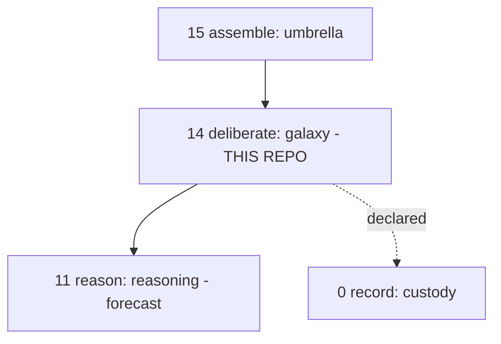
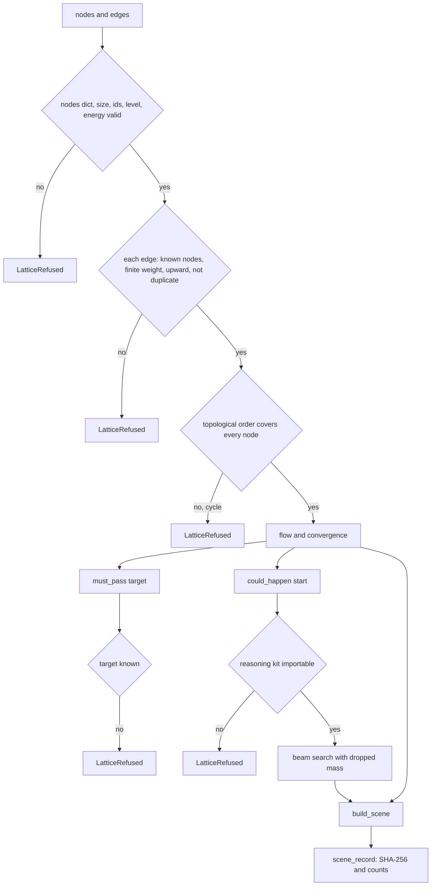

# vega-galaxy-sdk — Architecture

**Contents:** [Layer map](#where-it-sits) · [Components](#components) · [Workflow and its stops](#workflow-and-where-it-fails-closed) · [Custom constraints](#custom-constraints)

## Where it sits



```
 15 assemble   vega-umbrella-sdk
>>> 14 deliberate vega-galaxy-sdk   <-- THIS REPO
 11 reason     vega-reasoning-sdk   (used by could_happen)
  0 record     vega-custody-sdk     (declared dependency)
```

## Components

| Module | Concern | Uses |
|---|---|---|
| `lattice` | Graph model, flow, convergence, necessary conditions, futures | `vega_reasoning.aquire.forecast` (lazy) |
| `scene` | Deterministic scene and hash record | `lattice`, SHA-256 |

## Workflow and where it fails closed



| Stop point | Mechanism | Where |
|---|---|---|
| Malformed node or edge | raise | `Lattice.__init__` |
| Cycle | raise, never broken silently | `Lattice._topological` |
| Unknown target or start | raise | `must_pass`, `could_happen` |
| Missing reasoning kit | raise | `could_happen` |
| Bad scene input or horizon | raise | `build_scene`, `scene_record` |

## Custom constraints

This version publishes no user-defined constraint hooks; constraints are fixed by the module and the jurisdiction floor. User-defined constraints may be STRICTER than the legal minimum for the applicable jurisdiction, never looser. Jurisdictional legal minimums are defined by the jurisdiction registry (vega-jurisdiction-sdk); a custom constraint that would drop below a registered minimum is rejected at the gate.
