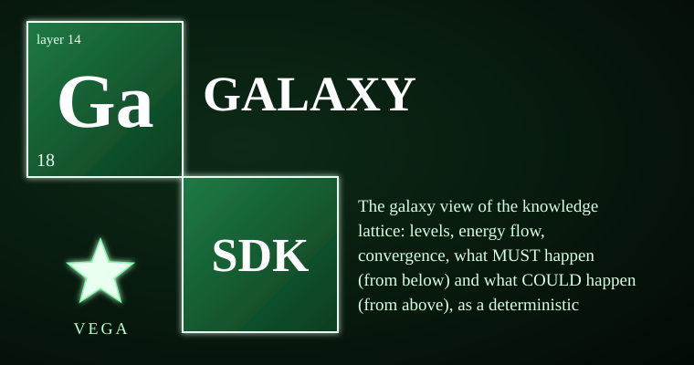
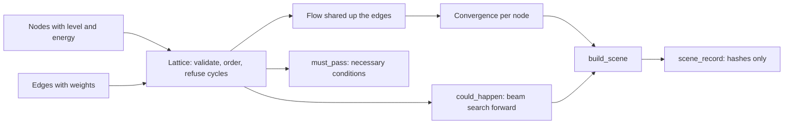

# vega-galaxy-sdk

<!-- vega-install-order -->
> **Build order: 3/3. This kit needs 2 other Vega kits installed first.** Install them in this order, then this one:
> 1/3 `vega-custody-sdk`  
> 2/3 `vega-reasoning-sdk`  
> 3/3 `vega-galaxy-sdk` (this kit)
> Install each with `pip install --no-deps git+https://github.com/jasonblasiak868-code/<name>` in the order shown. Full steps: [INTEGRATION_GUIDE](https://github.com/jasonblasiak868-code/vega-umbrella-sdk/blob/main/INTEGRATION_GUIDE.md).

**See what must happen and what could happen.** This kit turns a knowledge lattice into numbers and a deterministic 3D scene. From below it shows the conditions every path to a goal must pass through. From above it shows the likeliest futures, each with a confidence and an honest count of the probability it left out. It owns one concern in the Vega family: **the galaxy view of the knowledge lattice**.

> **Licensing.** Source-available, not open source. Free for personal use; free for registered small businesses (under US$1M revenue and valuation); everyone else needs a commercial license (see LICENSE; for a commercial license write to jasonblasiak.ai.mail@gmail.com). Patent pending. Draft licence text, not yet reviewed by an attorney.

## At a glance

| | |
|---|---|
| Package | `vega_galaxy` (src layout) |
| Version | 0.1.0 |
| Layer | 14 of 16, deliberate |
| Declared dependencies | vega-custody-sdk, vega-reasoning-sdk |
| Python | 3.10 or newer, pure Python |
| Tests | 36 tests in 3 files, all passing (STATUS.md) |
| Status | Reference implementation, work in progress |

**Contents:** [Why](#why-this-exists) · [Capabilities](#capabilities) · [Flow](#end-to-end-flow) · [Controls](#controls) · [Cannot do](#what-it-cannot-do) · [Platforms](#platform-support) · [Install](#install-standalone-and-unified) · [Diagnostics](#diagnostic-control) · [Fail closed](#fail-closed-and-custom-constraints) · [Family](#where-it-sits-in-the-family) · [Tests](#tests)

## Why this exists

A knowledge graph is hard to reason about by eye. People want two answers: "what has to be true before this outcome can happen?" and "where could this go next, and how sure are we?" A model asked those questions in prose can invent either answer.

This kit computes them. Energy is shared out along edges and never multiplied, convergence is a fixed formula, and the necessary conditions are the dominators of the goal, found in a single pass. The future view is a beam search that reports the probability it threw away. The same lattice always draws the same scene, and a hash-only record lets you prove a picture belongs to that exact lattice.

## Capabilities

| Capability | Where it lives | How you can check it |
|---|---|---|
| Lattice with 11 ordered levels and kinetic energy | `lattice.Lattice` | `tests/redteam_1_graph_and_views.py` |
| Flow shared up the edges, never multiplied | `Lattice.flow` | `tests/redteam_2_math_and_scale.py` |
| Convergence, 1 minus exp of minus 0.35 times incoming flow | `Lattice.convergence` | `tests/redteam_2_math_and_scale.py` |
| Necessary conditions from below (nodes on every path to a target) | `Lattice.must_pass` | `tests/redteam_1_graph_and_views.py` |
| Possibilities from above by beam search with dropped mass reported | `Lattice.could_happen` | `tests/redteam_1_graph_and_views.py` |
| Cycles, downward edges, duplicate edges and bad numbers refused | `Lattice.__init__` | `tests/redteam_1_graph_and_views.py` |
| Deterministic scene with black hole, brightness and a future layer | `scene.build_scene` | `tests/redteam_2_math_and_scale.py` |
| Hash-only scene record for the chain | `scene.scene_record` | `tests/redteam_1_graph_and_views.py` |

## End-to-end flow

1. **Build.** `Lattice(nodes, edges)` validates every node and edge and computes a topological order. A cycle is refused.
2. **Flow.** Each node's total is its own energy plus its share of every source's total, divided by that source's outgoing weight.
3. **Converge.** Convergence rises toward 1 as incoming flow grows.
4. **Look.** `must_pass(target)` returns the necessary conditions. `could_happen(start)` returns outcomes with probabilities.
5. **Draw.** `build_scene` places nodes by level (radius), a stable angle from the id, and total flow (height). The node with the highest convergence is the black hole; `black_hole_active` is false when nothing converges, so the label is not a claim.
6. **Prove.** `scene_record` returns hashes and counts for the chain.

## Controls

| Control | What it does |
|---|---|
| `Lattice(nodes, edges)` | Up to 20,000 nodes and 100,000 edges. Nodes are `id -> {level, energy}`. Edges are `(source, target, weight)`, same level or upward. |
| `flow()`, `convergence()` | The two computed views. Flow is computed once and cached. |
| `must_pass(target)` | Necessary conditions from below. |
| `could_happen(start, beam, depth)` | Futures from above. Defaults: beam 8, depth 6. |
| `build_scene(lat, future_from, beam, depth, horizon)` | Scene. `horizon` is a number from 0 to 1 that marks near-black-hole nodes. |
| `scene_record(scene)` | Hash-only record. |

## What it cannot do

- **The cosmology is a metaphor.** The numbers mean only what the formulas say.
- **The future layer is not a prediction.** It shows possibilities with confidence.
- **It does not repair a cycle.** A cyclic lattice is refused.
- **It does not render anything.** The 3D viewer is part of the Vega OS interface and is not in this package.
- **`must_pass` is not fast on huge graphs.** It removes each ancestor and re-checks reachability, so cost grows quickly with size.
- **Not production-hardened and not independently security-reviewed.** Passing tests and a clean scan are not proof of safety.
- **Crypto is not expert-reviewed.** Only SHA-256 hashing is used here.

## Platform support

| Platform | Support |
|---|---|
| Windows, macOS, Linux | Runs anywhere CPython 3.10+ runs. No POSIX-only calls found. |
| Android, iOS | No native mobile build is published. The SDK is pure Python and can run inside a Python runtime on Android (Termux) or Apple platforms (BeeWare/Kivy) where that runtime supports its dependencies. |

## Install standalone and unified

**Standalone.** `pip install -e .`. The package declares `vega-custody-sdk` and `vega-reasoning-sdk`. In this version the code imports only `vega_reasoning`, and only inside `could_happen`, so the flow, convergence and necessary-condition views work without it and the future view raises `LatticeRefused` if it is missing.

**Unified.** Registered in `vega-umbrella-sdk` as layer 14, `deliberate`. The umbrella resolves the wiring.

## Diagnostic control

No command-line tool or console script is published. The control surface is code: the dictionaries returned by `flow()`, `convergence()`, `must_pass()`, `could_happen()` and the scene itself, plus the record from `scene_record`. A diagnostic UI design for this layer exists in the Vega OS interface program; it is not shipped with this package.

## Fail closed and custom constraints

Bad input raises `LatticeRefused`. Nothing is repaired silently: cycles, downward edges, duplicates, non-finite numbers and unknown ids are all refused. The workflow with every stop is in [ARCHITECTURE.md](ARCHITECTURE.md).

User-defined constraints may be STRICTER than the legal minimum for the applicable jurisdiction, never looser. Jurisdictional legal minimums are defined by the jurisdiction registry (vega-jurisdiction-sdk); a custom constraint that would drop below a registered minimum is rejected at the gate. This version publishes no user-defined constraint hooks; constraints are fixed by the module and the jurisdiction floor.

## Where it sits in the family

Layer 14, deliberate, alongside the council kit. It reads forecasts from the reasoning layer and shows them. One family, one organism: every SDK owns exactly one concern and uses the owner of every other concern instead of growing its own copy.

## Tests

36 tests in 3 files, all passing (STATUS.md). Put this repo's `src` and the `src` of its dependencies on `PYTHONPATH`, then run each file in `tests/`.

## Status and honesty

A reference implementation and a work in progress. Not independently security-reviewed. See [SPEC.md](SPEC.md), [ARCHITECTURE.md](ARCHITECTURE.md), [CAPABILITIES.md](CAPABILITIES.md) and SECURITY.md.

Patent pending (U.S. provisional application 64/178,949 and others).

This kit details one branch of a broader filed architecture. The remaining branches are the subject of filed disclosures and are outside the scope of this repository.
